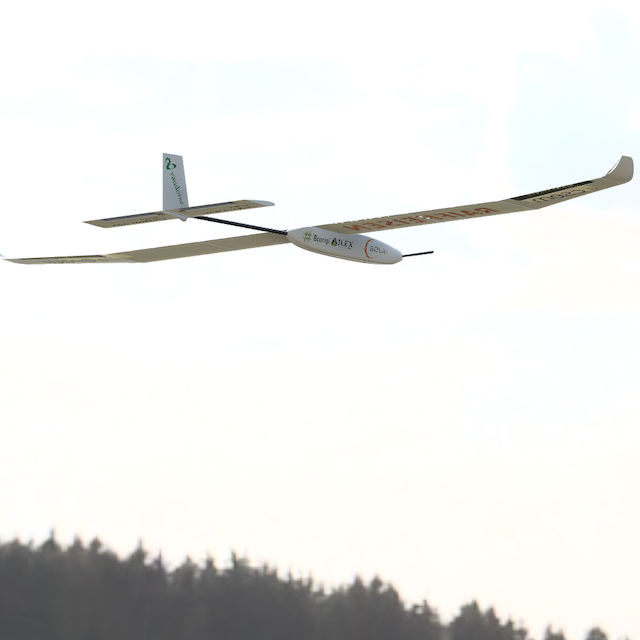
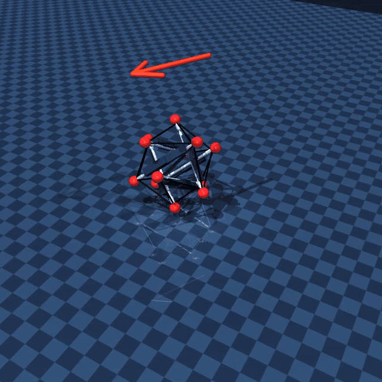

  

# Martin Mayer

**MSc Robotics @ EPFL · Learning-Based Control · Autonomous Systems · Embedded Robotics**

I build robotic systems from algorithms to hardware. My work spans reinforcement learning, control, embedded development, and system integration, with a strong interest in making intelligent robots work reliably in the real world.

[LinkedIn](https://www.linkedin.com/in/martin-mayer-0151b631b/) · [SOLA — Solar UAV](https://www.projetsola.com/) · [GitHub](https://github.com/MartinMayerEPFL)

## Selected projects

### SOLA — Long-Endurance Solar UAV
**Project President · Systems Engineering & Aerostructures**

Leading a multidisciplinary student team developing a **3 m wingspan autonomous solar-powered UAV**. Prototype IV targets **8+ hours of flight** using onboard solar energy. My work spans aircraft design, lightweight composite structures, aerodynamic trade-offs, energy management, avionics, and overall system integration.

**Focus:** Aerospace systems · Hardware integration · Composite structures · Autonomous flight  
**Explore:** [Project website](https://www.projetsola.com/)

 

### Tensegrity Robotics — Data-Efficient RL on Hardware
**EPFL Robotics Research Project · In progress**

Developing learning-based control for a pneumatic tensegrity  robot, aiming to learn directly 
from hardware while reducing manual resets. The project combines **discrete Soft Actor-Critic** 
**in JAX** with state estimation from motion capture and IMUs. The goal is command-conditioned 
locomotion for joystick control and waypoint following on real hardware.

**Focus:** Reinforcement learning · JAX · Discrete control · State estimation · Real-world robotics

**Code:** Research repository not currently public

 

### Quadruped Locomotion — Control & Reinforcement Learning
**EPFL Legged Robotics Projects**

Explored locomotion control in simulation, including **central pattern generators (CPGs)**, reinforcement learning, and gait generation. I also implemented and optimized a quadruped jumping controller through simulation-based experiments.

**Focus:** Python · PyBullet · Stable-Baselines3 · Optimization · Locomotion  
**Explore:** [Locomotion / CPG + RL](https://github.com/MartinMayerEPFL/Legged_Robot_Project2) · [Quadruped jumping](https://github.com/MartinMayerEPFL/LeggedProject1)

### Haptic Teleoperation — Bilateral Control
**EPFL Haptic Human-Robot Interfaces Project**

Worked with two haptic interfaces to investigate real-time bilateral control, force feedback, and communication delay. The project combines embedded control firmware, serial communication, and PC-side interface development.

**Focus:** Embedded C · C++/Qt · MATLAB · Control · UART  
**Explore:** [Haptic Teleoperation repository](https://github.com/MartinMayerEPFL/Haptic_Teleoperation)

## Technical interests & tools

- **Robotics & control:** Reinforcement learning, robot locomotion, state estimation, embedded control, autonomous systems
- **Programming:** Python, C/C++, JAX, MATLAB
- **Simulation & workflows:** MuJoCo, PyBullet, ROS 2, Git, Linux, HPC/Slurm
- **Hardware:** Sensors & motion capture, embedded electronics, aircraft structures, experimental integration

## Let's connect

I'm interested in robotics research and engineering that connects **learning, control, and real hardware**. Feel free to reach out on [LinkedIn](https://www.linkedin.com/in/martin-mayer-0151b631b/) or explore my [public repositories](https://github.com/MartinMayerEPFL?tab=repositories).
